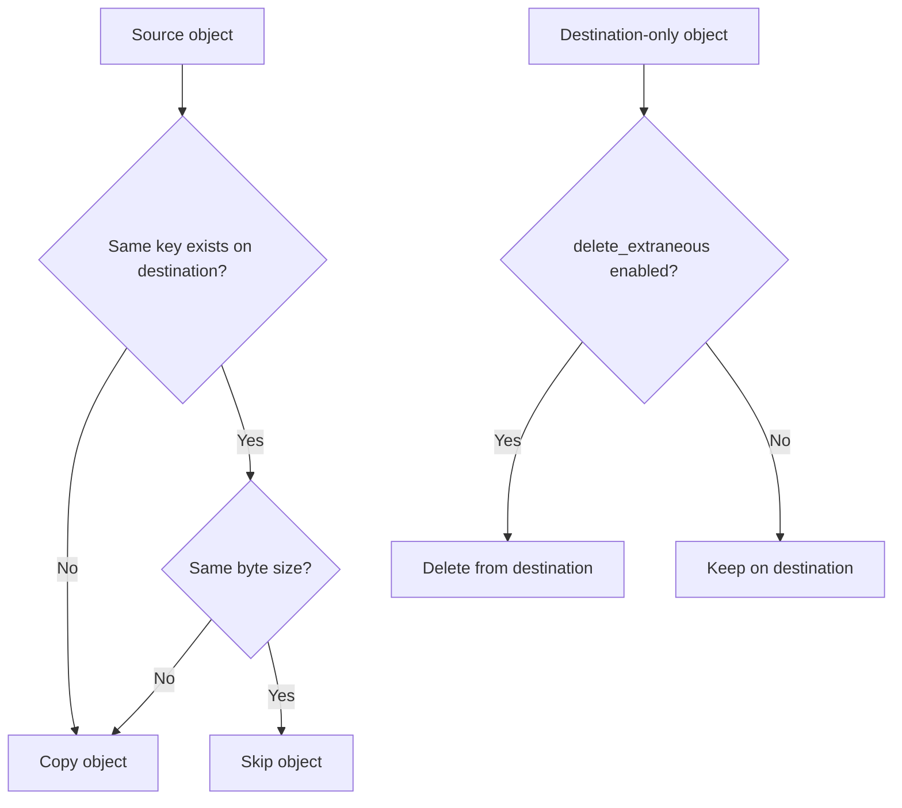

<p align="center">
  
</p>

<p align="center">
  <a href="https://github.com/netspeedy/s3mirror/actions/workflows/lint.yml"></a>
  <a href="https://github.com/netspeedy/s3mirror/actions/workflows/container-image.yml"></a>
  <a href="https://github.com/netspeedy/s3mirror/releases"></a>
  <a href="https://github.com/netspeedy/homebrew-s3mirror"></a>
  <a href="https://github.com/netspeedy/s3mirror/pkgs/container/s3mirror"></a>
  <a href="https://www.python.org/"></a>
  <a href="LICENSE"></a>
</p>

---

s3mirror copies buckets and objects from one S3-compatible endpoint to another:
AWS S3, MinIO, Ceph, Wasabi, Backblaze B2 or anything else that speaks the S3 API.
It finds every source bucket, creates any that are missing at the destination, and
copies objects that are new or whose size has changed. It can also remove objects
that exist only at the destination, so the destination ends up a true mirror.

It's one Python script with one config file, built on `boto3` so what it does is
easy to read and audit. It started as an alternative to vendor-specific mirror
tooling. Its logs work for a person at a terminal and for cron, systemd timers or
CI, and the exit code tells a scheduler whether the run went cleanly.

**Quick links:** [Install](#install) · [Try it](#try-it) · [Docs](https://netspeedy.github.io/s3mirror/) · [Deletion](https://netspeedy.github.io/s3mirror/how-it-works/deletion/) · [Config keys](https://netspeedy.github.io/s3mirror/reference/configuration/) · [CLI reference](https://netspeedy.github.io/s3mirror/reference/cli/) · [Releases](https://github.com/netspeedy/s3mirror/releases)

## Install

On macOS or Linux, Homebrew is the easiest route:

```bash
brew tap netspeedy/s3mirror
brew install s3mirror
```

> On recent Homebrew, new third-party taps require explicit trust. If installation is refused, run `brew trust netspeedy/s3mirror` once, then `brew install s3mirror`.

The container image is published to GHCR for `linux/amd64` and `linux/arm64`:

```bash
docker pull ghcr.io/netspeedy/s3mirror:latest
```

Or run it from a checkout. It needs Python 3.11 or newer, and its only
dependencies are `boto3`, `urllib3` and `PyYAML`:

```bash
git clone https://github.com/netspeedy/s3mirror.git
cd s3mirror
python3 -m venv .venv
. .venv/bin/activate
pip install -r requirements.txt
```

From a checkout the command is `python3 s3mirror.py` rather than `s3mirror`.

## Try it

Put both endpoints in a config file. Anything you leave out takes its default, so
this is enough to start:

```yaml
source:
  endpoint_url: "https://s3.source.example.com"
  aws_access_key_id: "SOURCE_ACCESS_KEY"
  aws_secret_access_key: "SOURCE_SECRET_KEY"

destination:
  endpoint_url: "https://s3.destination.example.com"
  aws_access_key_id: "DEST_ACCESS_KEY"
  aws_secret_access_key: "DEST_SECRET_KEY"
```

Make the first run copy-only, so nothing at the destination is deleted:

```bash
s3mirror --config config.yaml --no-delete
```

This run was against two local test endpoints. The destination already had
`app-data` with one matching object, one older copy of `config/settings.json` and a
stray `exports/old-report.csv`:

```text
======================================================================
S3 BUCKET MIRROR
Session started: 2026-11-04 02:39:49
======================================================================
✓ Source connected successfully (2 buckets)
✓ Destination connected successfully (1 buckets)

Starting synchronization of 2 bucket(s)
Performance: 20 workers, 8.0MB multipart threshold

======================================================================
[1/2]: app-data
======================================================================
  Source: 4 objects
  Destination: 3 objects
  Actions: 3 to copy (100.8KB), 0 to delete
  ✓ Copied 3 objects in 0.0s (9.9MB/s)
  ✓ Bucket completed in 0.0s

======================================================================
[2/2]: media-assets
======================================================================
  ✓ Created bucket: media-assets
  Source: 2 objects
  Destination: 0 objects
  Actions: 2 to copy (742.2KB), 0 to delete
  ✓ Copied 2 objects in 0.0s (112.1MB/s)
  ✓ Bucket completed in 0.0s

======================================================================
FINAL SUMMARY
======================================================================
Started:  2026-11-04 02:39:49
Finished: 2026-11-04 02:39:49
Duration: 0.1s (0s)

Buckets:
  - Processed: 2
  - Created:   1

Objects:
  - Copied:    5
  - Deleted:   0

Data transferred: 843.0KB
Average throughput: 14.7MB/s

✓ Status: COMPLETED SUCCESSFULLY
======================================================================
```

The two new exports and the changed `settings.json` were copied, the matching
export was skipped, and `media-assets` was created and filled. Run it again
without `--no-delete` and the stray `old-report.csv` is removed as well, because
deleting destination-only objects is on by default. Add `--debug` to see every
decision. `--show-config` prints the configuration s3mirror will actually use,
with the secret keys redacted.

Before a real first run:

1. Give s3mirror its own source credential, with read access to the buckets you want mirrored.
2. Give it its own destination credential that can list, create buckets and upload, plus delete if you'll allow deletion.
3. Run with `--no-delete` and `--debug` once, and check the bucket list, object counts and actions.
4. Only then let it delete, and for scheduled runs use `--log-file` and alert on a non-zero exit code.

## How it decides

For each source bucket it lists the objects on both sides with `list_objects_v2`
and compares them by key and size:



If either listing fails, on its first page or partway through, the bucket is
skipped with nothing copied or deleted and counted as an error, so a partial
listing never makes objects look extraneous.

It doesn't compare checksums, ETags, metadata, tags, storage class, ACLs,
retention settings or version history. That keeps it fast, but two objects with the
same key and size count as in sync even if their contents differ, metadata-only
changes aren't mirrored, and versioned history isn't replayed. Bucket policies and
lifecycle rules at the destination are left alone.

Copies stream from `get_object` into `upload_fileobj`, which switches to multipart
uploads above the configured threshold. Requests use path-style addressing and
botocore's adaptive retries: up to three retries, so four attempts in all.

## Configuration

The config file is YAML or JSON with four sections: `source`, `destination`,
`performance` and `sync`. This one sets every key:

```yaml
source:
  endpoint_url: "https://s3.source.example.com"
  aws_access_key_id: "SOURCE_ACCESS_KEY"
  aws_secret_access_key: "SOURCE_SECRET_KEY"
  region_name: "us-east-1"
  verify_ssl: true

destination:
  endpoint_url: "https://s3.destination.example.com"
  aws_access_key_id: "DEST_ACCESS_KEY"
  aws_secret_access_key: "DEST_SECRET_KEY"
  region_name: "us-east-1"
  verify_ssl: true

performance:
  max_workers: 20
  multipart_threshold: 8388608
  multipart_chunksize: 8388608
  max_concurrency: 10
  max_pool_connections: 50

sync:
  delete_extraneous: false
  exclude_buckets:
    - scratch-bucket
    - temporary-exports
```

`source` and `destination` take the same keys:

| Key | Default | Description |
|-----|---------|-------------|
| `endpoint_url` | placeholder | S3-compatible API endpoint URL. |
| `aws_access_key_id` | placeholder | Access key for the endpoint. |
| `aws_secret_access_key` | placeholder | Secret key for the endpoint. |
| `region_name` | `us-east-1` | Region passed to `boto3`, and on the destination, the region missing buckets are created in. Many non-AWS services still expect one. |
| `verify_ssl` | `true` | TLS certificate verification: `true`, `false`, or the path to a CA bundle for a private CA or a self-signed certificate. |

The endpoint and key defaults are the placeholders from the example above, such as
`https://s3.source.example.com` and `SOURCE_ACCESS_KEY`. They fail the connection
check, so set all three on both sides.

`verify_ssl` defaulted to `false` up to and including 1.0.4. A config that leaves it
out and points at an endpoint with a self-signed or private-CA certificate now fails
the connection check with `CERTIFICATE_VERIFY_FAILED`, so set it to the CA bundle's
path for that endpoint, or to `false` if you really can't verify it.

`performance` tunes transfers:

| Key | Default | Description |
|-----|---------|-------------|
| `max_workers` | `20` | Worker threads for copies and deletes. |
| `multipart_threshold` | `8388608` | Object size in bytes at which uploads become multipart. |
| `multipart_chunksize` | `8388608` | Multipart chunk size in bytes. |
| `max_concurrency` | `10` | Per-transfer concurrency in the `boto3` transfer config. |
| `max_pool_connections` | `50` | HTTP connection pool size for each S3 client. |

`sync` controls what gets mirrored:

| Key | Default | Description |
|-----|---------|-------------|
| `delete_extraneous` | `true` | Delete destination objects that don't exist in the source. |
| `exclude_buckets` | `[]` | Source bucket names to skip entirely. |

## Command-line flags

Flags override the config for a single run.

| Flag | Description |
|------|-------------|
| `-c`, `--config FILE` | Config file, `.yaml`, `.yml` or `.json`. Every real run needs one. |
| `-w`, `--workers N` | Override `max_workers`. |
| `--no-delete` | Don't delete destination-only objects, whatever `delete_extraneous` says. |
| `-q`, `--quiet` | Errors only on the console. |
| `-d`, `--debug` | Verbose output, including every transfer decision. |
| `-l`, `--log-file FILE` | Write a full debug log to a file. The console shows only errors unless `--debug` is also set. |
| `--show-config` | Print the effective configuration with secret keys redacted, then exit. |
| `--version` | Print the version and exit. |

## Running it on a schedule

For cron or a systemd timer, log to a file and keep the console quiet:

```bash
s3mirror --config /etc/s3mirror.yaml --log-file /var/log/s3mirror.log --quiet
```

Each run starts the log file with a session header, so it can be tailed or rotated
by other tools. s3mirror exits `0` when the run finishes without errors and `1`
when anything went wrong, including a bad config or an endpoint it can't reach. A
bad flag or flag value exits `2` before anything runs, and Ctrl+C exits `130`. Alert
on any non-zero exit code. The final summary reports buckets processed and created, objects
copied and deleted, data transferred, average throughput and the error count.

| Mode | Console | Log file | Typical use |
|------|---------|----------|-------------|
| Normal | Progress and summary | None | Interactive runs |
| `--debug` | Every decision, with levels | None | Troubleshooting |
| `--quiet` | Errors only | None | Minimal cron output |
| `--log-file` | Errors only, unless `--debug` is set | Full debug log with timestamps | Production automation |

## Container image

Stable releases are published to
[`ghcr.io/netspeedy/s3mirror`](https://github.com/netspeedy/s3mirror/pkgs/container/s3mirror)
with the tags `latest`, the version (`X.Y.Z`), the minor version (`X.Y`) and the Git
tag (`vX.Y.Z`). Mount the config and pass the same flags:

```bash
docker run --rm \
  -v "$PWD/config.yaml:/config/config.yaml:ro" \
  ghcr.io/netspeedy/s3mirror:latest \
  --config /config/config.yaml --no-delete --debug
```

For scheduled jobs, pin the version you've tested, from
[Releases](https://github.com/netspeedy/s3mirror/releases), in place of `X.Y.Z`, and
mount somewhere for the log:

```bash
docker run --rm \
  -v /etc/s3mirror.yaml:/config/config.yaml:ro \
  -v /var/log/s3mirror:/logs \
  ghcr.io/netspeedy/s3mirror:X.Y.Z \
  --config /config/config.yaml --log-file /logs/s3mirror.log --quiet
```

## Safety

s3mirror can delete data from the destination, and with the default config it
will. With `delete_extraneous: true`, anything at the destination that isn't in the
source is removed, including objects someone wrote straight to the destination on
purpose. Use `--no-delete` for a single run, or set `delete_extraneous: false` to
turn it off for good.

Give it credentials that can only do what the mirror needs. Exclude buckets that
are temporary, test-only or belong only to the destination. Keep independent
backups of anything critical before you enable deletion. Try new endpoints and
credential changes against a non-production bucket first.

## Troubleshooting

If connecting fails, run with `--debug` and check the endpoint URL and scheme, the
keys, the region the provider expects, `verify_ssl`, and whether firewalls, DNS or
proxies let the machine reach both endpoints. If destination buckets aren't
created, the destination credential probably can't create buckets, or the provider
wants them created in a particular region or ahead of time.

If an object isn't copied again, its key and size match, so s3mirror considers it
in sync. Delete or rename the destination copy to force a copy. If cron output is
too noisy, use `--quiet` with `--log-file`. With `verify_ssl: false`, s3mirror logs
one `⚠ TLS certificate verification is off` line for that endpoint in place of
`urllib3`'s per-request warnings, but the TLS risk is still there.

## Development

Install the runtime and development dependencies, then run the same checks the
Lint workflow runs on every pull request:

```bash
python3 -m pip install -r requirements.txt
python3 -m pip install black isort pylint pytest "moto[s3,server]"
black --check s3mirror.py tests
isort --check-only s3mirror.py tests
pylint s3mirror.py tests
make test
make container-smoke
```

The tests in `tests/test_mirror.py` run s3mirror against two moto S3 servers that
`tests/conftest.py` starts on localhost, one for each side, and inject failures into
the calls s3mirror makes, so they need no network access or credentials.

The Lint workflow runs pylint, black, isort and the tests on Python 3.11 to 3.14,
builds the container, and builds and checks the website. Pushes to `main` are
formatted with black and isort automatically. Container Image publishes the
multi-arch image when a stable tag is pushed, after checking that the tag is on
`main` and matches `s3mirror.py --version`. Dependabot checks the Python packages,
the Docker base image, the Actions and the website weekly, and green Dependabot
pull requests are merged automatically.

Automated Release tags `v<__version__>` when that tag doesn't exist yet, which
publishes the image, the Homebrew formula and the GitHub release, with notes
generated from the pull requests since the previous release, so you release a change of your own
by bumping `__version__` in its pull request. Automated updates release
themselves: when release-bearing commits have landed since the last tag
(`feat:`, `fix:`, `deps:`, `build:` and the others
`scripts/release/next-release.sh` counts) and every one came from Dependabot,
Renovate or this repository's workflows, Automated Release bumps `__version__`
itself and the run for that commit tags it. Dependabot
titles Python and base-image updates `deps:`, so they ship on their own, while
Actions updates are `ci:` and website updates `chore:`.

The [docs site](https://netspeedy.github.io/s3mirror/) is built with Astro and
Starlight from `website/`, and its [README](website/README.md) covers the `make
website-*` targets and how the site is published. If you change a flag, a config
key, a log line or what gets deleted, update the matching pages in the same change.
`tests/test_docs.py` fails until the CLI reference page lists exactly the flags the
parser accepts. [AGENTS.md](AGENTS.md) has the repository's conventions in full.

The banner at the top of this page and the social cards are generated. Edit the
copy, layout or timing in `scripts/readme/build_readme_hero.py` and run `make
readme-hero`. That rebuilds `assets/s3mirror-readme-hero.svg`, the website's share
card, mark and icons, and `assets/s3mirror-social-card.png`, which is the image for
GitHub's social preview and is uploaded by hand in the repository settings. It runs
the script with `uv`, which installs the pinned fontTools it subsets the fonts
with, and renders the cards and icons with headless Chrome or Chromium. The fonts
come from assets.netspeedy.io, so the first run needs network access. If you change
the headline's words, measure them again with `uv run
scripts/readme/measure_headline.py`.

Contributions are welcome. Checksum-aware change detection, mirroring metadata,
tags or storage class, and notes on particular providers would all be useful. Keep
pull requests focused, run the checks above, and say plainly if a change affects
deletion, safety or compatibility.

## License

Copyright © 2026 [Simon Oakes](https://github.com/soakes). Released under the
[MIT License](LICENSE).

`s3mirror` is an independent community tool and is not affiliated with, endorsed
by, or sponsored by AWS or any of the storage providers it works with.
